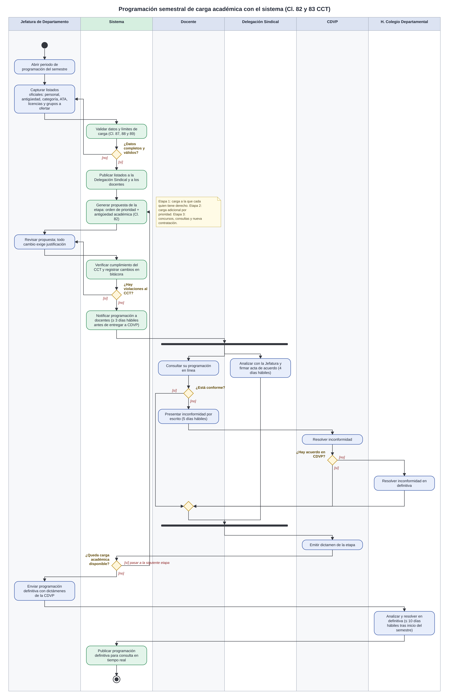

# Prototipo de Programación Académica (CCT STAUS–UNISON)

**Pruébalo aquí:** https://kevinnunez-bit.github.io/prototipo-programacion/

Prototipo que hice para el servicio social. Simula cómo se haría la programación semestral de la carga académica siguiendo lo que dice el Contrato Colectivo de Trabajo 2025-2027, sobre todo las cláusulas 82 y 83.

El prototipo está hecho para seguir el contrato tal cual, sin agregarle reglas nuestras. La Jefatura es la que asigna los grupos. El sistema solo muestra el orden de prioridad del contrato, los plazos y lo que hay que entregarle a cada parte (Delegación Sindical, CDVP y H. Colegio Departamental).

> Todos los datos (docentes, grupos y horarios) son inventados. No es información real de ningún departamento.

## Diagrama del proceso

Este es el diagrama de actividad (UML, con carriles) del proceso de programación que presenté en la junta:



## Qué se necesita

- Un navegador (Chrome, Firefox, Edge, etc.).
- Python 3, solo si lo quieres correr con servidor local (opcional).

No hay que instalar dependencias. Está hecho con HTML, CSS y JavaScript puro en un solo archivo (`index.html`).

## Cómo correrlo

Primero descarga el repositorio:

```bash
git clone https://github.com/KevinNunez-bit/prototipo-programacion.git
cd prototipo-programacion
```

O desde GitHub: botón **Code → Download ZIP** y lo descomprimes.

### Opción 1: abrirlo directo

Abre `index.html` con doble clic y se abre en el navegador.

### Opción 2: con servidor local

```bash
python3 -m http.server 8080
```

(En Windows puede ser `python -m http.server 8080`.)

Luego entra a <http://localhost:8080>. Para detenerlo, `Ctrl + C` en la terminal.

> Si no hay internet funciona igual, solo que las letras se ven con la tipografía por defecto porque las fuentes se cargan de Google Fonts.

## Cómo se usa

El prototipo va por pasos, en el mismo orden que el procedimiento del contrato:

1. **Listados oficiales.** Los 6 listados que la Jefatura publica y entrega a la Delegación Sindical antes de programar (Cl. 83).
2. **Primera Etapa.** La Jefatura asigna los grupos con los botones "+". La tabla muestra a los docentes en el orden de prioridad de la Cl. 82, con su antigüedad, ATA y horario previo.
3. **Segunda Etapa.** Se reparte la carga que sobró como carga adicional, en el orden de la Segunda Etapa.
4. **CDVP, primera reunión.** Se resuelven las inconformidades y se da el dictamen de las Etapas 1 y 2.
5. **Tercera Etapa.** Concursos de evaluación curricular, consultas si el concurso queda desierto y propuesta de contratación.
6. **H. Colegio Departamental.** Se envía la programación definitiva y el Colegio resuelve.

En cada etapa hay que notificar a los docentes, entregar a la CDVP y firmar el acta con la Delegación Sindical.

Además:

- **Plazos:** en el panel de la derecha pones la fecha de inicio del semestre y calcula las fechas límite en días hábiles (Cl. 83).
- **Avisos:** lista de lo que se le informa a la Delegación Sindical, a la CDVP y a los docentes (Cl. 83, punto 8).
- **Consulta del docente:** cada docente puede ver su programación y presentar una inconformidad (Cl. 83).

Para no asignar grupo por grupo en una demostración, cada etapa tiene el botón **"Cargar un ejemplo de programación"**. El botón **Reiniciar** deja todo como al inicio.

## Cláusulas que se tomaron en cuenta

| Cláusula | Qué se usó |
|---|---|
| 82 | Orden de prioridad de la Primera, Segunda y Tercera Etapa |
| 83 | Listados, plazos, notificaciones, inconformidades, CDVP, actas y Colegio |
| 87 | Carga del personal de carrera (Titular 5–9 h, Asociado 10–12 h) |
| 88 | Sobrecarga del personal de carrera (hasta 4 h en tiempo completo) |
| 89 | Máximo de 25 horas para profesores de asignatura |
| 92 y 95 | Días inhábiles para calcular los plazos (vacaciones de invierno y 2 de noviembre) |

## Limitaciones

- Es un prototipo: no guarda nada, todo se pierde al recargar la página.
- No hay usuarios ni inicio de sesión; se puede ver todo desde una sola pantalla.
- El sistema no bloquea asignaciones fuera de orden, porque el contrato deja la verificación a la CDVP.
- Los datos de ejemplo no incluyen todos los casos del contrato (por ejemplo visitantes, profesores de otros departamentos, medio tiempo, posgrado ni cursos de verano).
- Los días hábiles solo descuentan fines de semana y los días que vienen en el contrato; los demás días inhábiles saldrían del calendario escolar.


